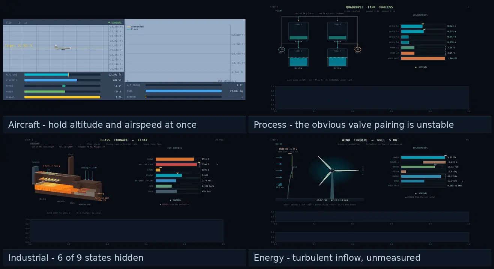

<h1 align="center">TargetGym</h1>

<h3 align="center">
  25 JAX environments for setpoint tracking,<br/>
  with tuned PID and MPC baselines.
</h3>

<p align="center"><i>Reach the target. Then hold it.</i></p>

<p align="center">
  <a href="https://yannberthelot.github.io/TargetGym/"></a>
  <a href="https://pypi.org/project/target-gym/"></a>
  <a href="https://pypi.org/project/target-gym/"></a>
  <a href="https://github.com/YannBerthelot/TargetGym/actions"></a>
  <a href="#license"></a>
  
  <a href="https://colab.research.google.com/github/YannBerthelot/TargetGym/blob/main/notebooks/quickstart.ipynb"></a>
</p>

<p align="center">
  <br/>
  <sub>One example task from each family, under PID control.</sub>
</p>

TargetGym provides reinforcement learning environments for **target MDPs**:
tasks where the objective is to reach a setpoint and hold it against
disturbances, rather than to reach a goal state once. The environments model
real plants, including an A320-like aircraft, a glass furnace, a nuclear
reactor, a cement kiln, a grid battery and a wind turbine.

**0.8.0 is a beta.** Four tasks are scored, each against a reference
controller frozen in the package. To compare an agent with it, start with
[Comparing an agent with the reference](docs/comparing.md), and read
[Known limits](docs/known-limits.md) before quoting a result.

- **Four scored tasks.** `reactor`, `hvac`, `compressor_surge` and
  `ph_neutralization` are scored: each has a measured reference to beat and a
  ceiling. The other twenty-one run the same way and are not scored yet, so no
  result is published for them. See [Environments](#environments).
- **Baselines included.** Every environment ships a tuned PID, and all but six
  an MPC with full state access: a line for context, which can lose to the
  reference, not a bound. For the scored tasks both are recorded in
  `src/target_gym/data/`, beside each task's reference.
- **Validated physics.** Each environment carries a `PHYSICS.md` with a sourced
  parameter table, published validation targets asserted by tests, and its
  documented approximations.
- **JAX throughout.** `jit`, `vmap` and `scan` compatible, end-to-end GPU,
  0.6 M to 700 M steps/s on CPU depending on the plant.
- **gymnax API**, with a Gymnasium wrapper for non-JAX libraries and a JaxMARL
  interface for the multi-agent formation task.

Learned-policy results are not published yet. The measurement protocol is
defined in [docs/rl-protocol.md](docs/rl-protocol.md).

---

## Installation

```bash
pip install target-gym
```

TargetGym is in active development: PyPI releases are the stable line, and
`main` can change quickly between them. The
[documentation](https://yannberthelot.github.io/TargetGym/) opens on the
latest release, and its version menu also has `dev`, which follows `main`. To
install `main`:

```bash
pip install "git+https://github.com/YannBerthelot/TargetGym"
```

Videos and the aircraft dashboards need `pip install 'target-gym[render]'`.

## Quickstart

Also available as a [Colab notebook](https://colab.research.google.com/github/YannBerthelot/TargetGym/blob/main/notebooks/quickstart.ipynb).

```python
import jax
import target_gym as tg

env, params = tg.make("hvac")           # the scored configuration
expert = tg.make_expert("hvac")         # the shipped expert

key, reset_key = jax.random.split(jax.random.PRNGKey(0))
obs, state = env.reset(reset_key, params)
memory = expert.reset()                 # carried like the env's state

total = 0.0
for _ in range(params.max_steps_in_episode):
    key, step_key = jax.random.split(key)   # a fresh key every step
    action, memory = expert.step(memory, obs)
    obs, state, reward, terminated, truncated, _ = env.step(step_key, state, action, params)
    total += float(reward)
    if terminated or truncated:
        break

print("Expert return:", total)
```

`tg.make(name)` returns the environment and the configuration the published
baselines are scored on, as `gymnax.make` does, and `reset` and `step` follow
the [gymnax](https://github.com/RobertTLange/gymnax) API. Keyword arguments
change single fields, as in `tg.make("hvac", max_steps_in_episode=500)`, and
`tg.make("hvac", scenario="cold_snap")` gives one of the task's scenarios.
`tg.list_envs()` gives the 25 names, and `tg.FLAGSHIP` the four that are scored.

The expert's memory is its PID's integral and last error. You carry it as
you carry `state`, so the same `expert.step` also runs under `jit`, `vmap`
and `lax.scan`. [Using the PIDs](docs/using-the-pids.md) shows batches,
evaluation and training on the experts.

<details>
<summary>Non-JAX libraries, e.g. stable-baselines3</summary>

End-to-end GPU requires a JAX-based library.

```python
# doc: agent -- needs stable-baselines3: pip install stable-baselines3
import target_gym as tg
from stable_baselines3 import SAC

env = tg.make_gymnasium("plane")
model = SAC("MlpPolicy", env, verbose=1)
model.learn(total_timesteps=10_000, log_interval=4)

obs, info = env.reset()
while True:
    action, _states = model.predict(obs, deterministic=True)
    obs, reward, terminated, truncated, info = env.step(action)
    if terminated or truncated:
        break
```

</details>

### Comparing an agent with the reference

`tg.score` runs your policy and the task's reference on the same seeds of
every scenario, and gives the saving over the reference, with its interval and
one row per scenario:

```python
# doc: records -- builds a frozen reference
import jax.numpy as jnp
import target_gym as tg


def policy(obs):  # your policy(obs) -> action; here both valves at mid-stroke
    return jnp.zeros(2)


m = tg.score("ph_neutralization", policy, seeds=(200,))  # all 10 seeds for a result
print(f"saving {m['saving']:+.1%} over the reference, interval {m['saving_ci']}")
```

`tg.make_reference(name)` is that reference, stepped as the expert is.
Beating `tg.make_expert(name)`, the shipped expert, is a weaker claim, and
`tg.score_policy` runs any registered task against it.
[Comparing an agent with the reference](docs/comparing.md) says how to train
on the scenarios, where to choose checkpoints and how to read the result.

The expert and the reference read `obs` only, as a plant controller does. The
oracle (`tg.make_oracle`) reads the full state, including quantities the
observation withholds, so it shows what a model-based controller could do
rather than competing with a policy;
[Baseline results](https://yannberthelot.github.io/TargetGym/latest/baseline-results/)
gives the numbers.

Vectorised rollouts, the registry, the patrol interface and the wind model
are covered in [docs/getting-started.md](docs/getting-started.md).

---

## Environments

25 tasks are registered, and every one of them runs through `tg.make`. Four
are scored. Of the other twenty-one, eleven are under review, nine are kept as
Extra and one is a test fixture.

### The scored suite

A scored task has a measured reference to beat, a ceiling and the room between
them on its page, and its numbers are kept current with the code. Results are
published for these four only.

| Task | Family | Plant |
|---|---|---|
| [`reactor`](docs/environments/reactor.md) | Industrial / Energy | A pressurised water reactor following a day's load plan |
| [`hvac`](docs/environments/hvac.md) | Industrial / Energy | An office heated through a concrete slab |
| [`compressor_surge`](docs/environments/compressor_surge.md) | Industrial / Energy | A variable-speed compressor held off its surge line |
| [`ph_neutralization`](docs/environments/ph_neutralization.md) | Process Control | A two-stage acid neutralisation kept inside its discharge permit |

### Registered, not scored

These tasks have the same interface and ship the same controllers, but no
result is published for them. Most are under review and can join the scored
suite in a later release. A few are kept as Extra, with the reason on their
page, and `first_order` is a test fixture.

| Family | Tasks |
|---|---|
| **Aircraft** | `plane`, `plane_energy`, `plane_sine`, `plane3d_heading`, `plane3d_circle`, `plane3d_racetrack`, `plane3d_figure8`, `patrol`, `patrol_range_bearing`, `wake_surf`, `formation` |
| **Process Control** | `cstr`, `first_order`, `four_tank`, `distillation`, `unstable_cstr` |
| **Industrial / Energy** | `glass_furnace`, `cement_kiln`, `boiler_drum` |
| **Renewable Energy** | `wind_turbine`, `battery` |

**[Full environment reference →](docs/environments.md)** with each task's
status, observation and action shapes, tracked variables and physics contract.

The CSTR, first-order and four-tank models are adapted from
[PC-gym](https://github.com/MaximilianB2/pc-gym) and checked against its source
term by term, as each `PHYSICS.md` provenance line records.

In the two patrol environments a follower holds a slot on a scripted lead, so
the reference is another aircraft. In `formation` the lead is a learner too: a
lead and two wingmen share one team cost, with a JaxMARL-style interface that
gives each aircraft its own observation and action. See
[Multi-agent formation](docs/multi-agent.md).

To pick a task by what you want your method to face (an unstable plant,
coupled inputs, a transport delay, hidden state, a moving or hidden reference,
several agents), see
**[Choosing an environment](docs/complexity.md)**.

Each environment renders a control-room dashboard: plant schematic, gauges with
limit and setpoint markers, strip charts, and explicit marking of quantities the
controller cannot measure. See the **[rendering guide](docs/rendering.md)**.

---

## Why setpoint tracking

Holding a setpoint indefinitely exposes failure modes that episodic goal-reaching
does not:

| Property | In the suite | Why it is hard to learn |
|---|---|---|
| **Irrecoverable states** | A drum that carries water into the turbine, a reactor past runaway, a kiln gone cold | Reaching one trips the plant, and that one step is charged the restart's whole downtime |
| **Deep partial observability** | The furnace hides 6 of 9 states, the reactor 7 of 11, the kiln 64 behind 8 measurements | The policy has to infer what it cannot measure |
| **Wrong-way-first response** | Opening the steam valve makes drum level *rise* before it falls, as steam bubbles expand | A controller following the immediate trend pushes the loop the wrong way |
| **Transport delay** | Half the kiln's response to a fuel change arrives a 25-minute residence time later | Credit assignment spans hundreds of steps |
| **Multi-timescale dynamics** | Millisecond neutronics against hour-long xenon; sub-second flame gas against 30-hour glass residence | One control interval cannot serve both ends |

Also modelled: actuator lag, competing objectives, and scheduled setpoints that
reward anticipation (the building's night setback and the furnace's crown
schedule). Aircraft fly in steady wind, altitude shear and
Ornstein-Uhlenbeck turbulence, unobservable by default.

---

## Baselines

How the two shipped controllers compare on the scored tasks: how many times
cheaper the oracle (a full-state MPC) holds each target than the expert, and
where the ceiling sits, tracking within the instruments' resolution. The
[interactive version](https://yannberthelot.github.io/TargetGym/latest/baseline-results/#at-a-glance)
can also anchor on the ceiling and gives the numbers.

<picture>
  <source media="(prefers-color-scheme: dark)" srcset="https://yannberthelot.github.io/TargetGym/latest/images/results-vs-expert-dark.svg">
  
</picture>

Every environment ships a tuned PID, and all but six (`cstr`, `wake_surf`,
`plane`, `plane_energy`, `plane3d_heading` and `plane3d_racetrack`) an MPC. On `patrol_range_bearing`, which
withholds the slot error a planner would read, the MPC slot holds `patrol`'s
oracle reading the true state, labelled a full-state bound.

Controller structure is chosen per plant:

- **Boiler drum**: three-element control, so feedwater tracks measured steam
  flow and shrink-and-swell cannot mislead the level loop.
- **Cement kiln**: cascade, because integral action on a 25-minute-old
  measurement oscillates at the delay period.
- **Four-tank**: crossed loops, since the negative RGA element makes the
  diagonal pairing unstable.
- **Unstable CSTR**: cascade, an outer PI on concentration setting the
  temperature an inner PD holds, since no P or PI loop on concentration alone
  can stabilise the reactor's middle steady state.
- **Compressor surge**: a pressure PI on the drive's speed and an anti-surge PI
  on the recycle valve, with a full-opening override near the surge line. This
  is the pairing industrial anti-surge systems use, and the recycle valve gets
  a loop of its own because the margin it protects is not a tracked output.

The MPC slot holds the best controller each task allows: on eleven process and
industrial plants a shared interior-point planner (`target_gym.oracles`), which
plans the episode's reward on the plant with its noise zeroed, on the pH plant
and the reactor a second-order planner (iterative LQR) through the JAX
dynamics, on the aircraft and the distillation column gradient-based planning
through them, and on
the patrol tasks the lead's own autopilot flown on the follower's state with a
short residual planner on top. Solver convergence is recorded alongside every
result.

Each baseline must beat the best constant action on its environment, a
deliberately low bar that a mis-wired controller fails. Weak baselines are
documented as such on their environment page.

> **A PID losing on a task says something about that task, not about PID
> control.** These environments are selected for problems where anticipation
> pays. Where reacting to the reference and the disturbances is sufficient, a
> PID is optimal or close enough that the difference does not appear in a
> return. Two environments were corrected after measurement showed exactly
> this: a battery whose dispatch signal was mostly noise, and a patrol follower
> tracking a lead at one fixed turn rate, which a single feedforward term
> cancels.

**[How the baselines work](docs/baselines.md)** says how each controller is
built and what to know before quoting an MPC number; the numbers are on
**[Baseline results](https://yannberthelot.github.io/TargetGym/latest/baseline-results/)**.

---

## Physics validation

Each environment carries a `PHYSICS.md` stating what it models and where that
holds, a parameter table citing or deriving every constant (flagged
`TUNED - not sourced` when neither applies), the published numbers it must
reproduce, and its known deviations.

Tests assert consequences rather than formulas: ISA table values, L/D ratios,
thermal time constants, energy balances, equilibria. A test that recomputes the
implementation's own expression would pass on a wrong one.

All 25 environments are covered by eighteen contracts, since aircraft variants
share a plant. A shared conformance suite additionally checks determinism, PRNG
handling, `jit`/`vmap`/`scan` compatibility and numerical health over full
episodes.

**[docs/PHYSICS_METHODOLOGY.md](docs/PHYSICS_METHODOLOGY.md)** documents the
method and lists what each model is validated against.

---

## Documentation

| | |
|---|---|
| **[Comparing an agent with the reference](docs/comparing.md)** | `tg.score`: the saving over each scored task's reference, and how to read it |
| **[Known limits](docs/known-limits.md)** | What this release's room, lines and results do not say yet |
| **[Getting started](docs/getting-started.md)** | Episodes, vectorised rollouts, the registry, Gymnasium |
| **[Using the PIDs](docs/using-the-pids.md)** | Running the baseline, scoring against it, using it in training |
| **[Environment reference](docs/environments.md)** | All 25: shapes, tracked variables, baselines, contracts |
| **[Choosing an environment](docs/complexity.md)** | Which task to start with for what you want to test |
| **[Public API](docs/api.md)** | Stable and provisional surface |
| **[Baseline results](https://yannberthelot.github.io/TargetGym/latest/baseline-results/)** | PID and MPC scores on every environment |
| **[RL protocol](docs/rl-protocol.md)** | Measuring a learned policy |
| **[Target MDPs](docs/target-mdp.md)** | The formal setting |
| **[How the baselines work](docs/baselines.md)** | PID and MPC controllers, tuning, solver reporting |
| **[Reward shaping](docs/reward-shaping.md)** | The reward and why it has that shape |
| **[Rendering](docs/rendering.md)** | Dashboards, toolkits, regenerating media |
| **[Throughput](docs/performance.md)** | Steps per second per environment |
| **[Physics methodology](docs/PHYSICS_METHODOLOGY.md)** | Sourcing, validation, bounds |
| **[Model review checklist](docs/model-review-checklist.md)** | Thirteen checks for any plant model |
| **[Testing](docs/testing.md)** | Suite organisation |

Rendered with search and navigation at
**[yannberthelot.github.io/TargetGym](https://yannberthelot.github.io/TargetGym/)**.
The links above point at the Markdown in this repository, which reads on
GitHub and is rewritten for the site at build time.

---

## Related projects

- **[gymnax](https://github.com/RobertTLange/gymnax)**: the JAX environment API
  TargetGym implements.
- **[Gymnasium](https://github.com/Farama-Foundation/Gymnasium)**: supported
  through a wrapper for non-JAX libraries.
- **[PC-gym](https://github.com/MaximilianB2/pc-gym)**: process-control
  environments; source of the CSTR, first-order and four-tank models.
- **[safe-control-gym](https://github.com/utiasDSL/safe-control-gym)**: closest
  in intent, comparing classical control, MPC and RL on shared tasks. It covers
  more controllers, TargetGym covers more plants.
- **[JaxMARL](https://github.com/FLAIROX/JaxMARL)**: the multi-agent API the
  formation task follows.

---

## Roadmap

Rewards, physics, baselines and the measurement protocol are settled.
Outstanding before 1.0: published learned-policy results. Known gaps are recorded rather than omitted.

**[Full roadmap →](docs/roadmap.md)**

## Contributing

Bug reports, new environments, improved baselines and physics corrections are
welcome.

```bash
git clone https://github.com/YannBerthelot/TargetGym.git
cd TargetGym
uv sync --group dev
make ci                # ruff, black --check, docs, fast tests
```

Further targets: `make test`, `make test-all`, `make figures`, `make videos`,
`make tuning`.

Adding an environment means registering an `EnvSpec`, which inherits every
shared check, and writing a `PHYSICS.md` sourcing its numbers.
**[CONTRIBUTING.md](CONTRIBUTING.md)** has the details.

---

## Citation

```bibtex
@misc{targetgym2025,
  title        = {TargetGym: Reinforcement Learning Environments for Target MDPs},
  author       = {Yann Berthelot},
  year         = {2025},
  url          = {https://github.com/YannBerthelot/TargetGym},
  note         = {Lightweight physics-based RL environments for aircraft, process control, and industrial systems}
}
```

## License

MIT.
