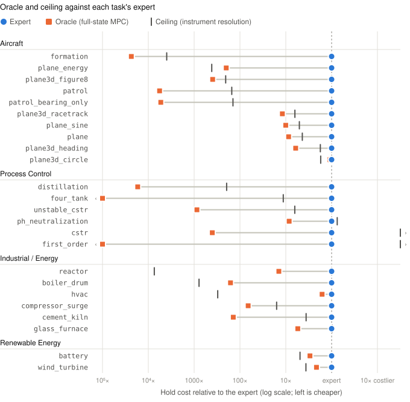

<h1 align="center">TargetGym</h1>

<h3 align="center">
  24 JAX environments for setpoint tracking,<br/>
  with tuned PID and MPC baselines.
</h3>

<p align="center"><i>Reach the target. Then hold it.</i></p>

<p align="center">
  <a href="https://yannberthelot.github.io/TargetGym/"></a>
  <a href="https://pypi.org/project/target-gym/"></a>
  <a href="https://pypi.org/project/target-gym/"></a>
  <a href="https://github.com/YannBerthelot/TargetGym/actions"></a>
  <a href="#license"></a>
  
  <a href="https://colab.research.google.com/github/YannBerthelot/TargetGym/blob/main/notebooks/quickstart.ipynb"></a>
</p>

<p align="center">
  <br/>
  <sub>One example task from each family, under PID control.</sub>
</p>

TargetGym provides reinforcement learning environments for **target MDPs**:
tasks where the objective is to reach a setpoint and hold it against
disturbances, rather than to reach a goal state once. The environments model
real plants, including an A320-like aircraft, a glass furnace, a nuclear
reactor, a cement kiln, a grid battery and a wind turbine.

- **Baselines included.** Every environment ships a tuned PID and an MPC
  with full state access, which serves as an upper bound. Both are recorded
  over ten seeds in `src/target_gym/data/baseline_returns.json`.
- **Validated physics.** Each environment carries a `PHYSICS.md` with a sourced
  parameter table, published validation targets asserted by tests, and its
  documented approximations.
- **JAX throughout.** `jit`, `vmap` and `scan` compatible, end-to-end GPU,
  0.6 M to 700 M steps/s on CPU depending on the plant.
- **gymnax API**, with a Gymnasium wrapper for non-JAX libraries and a JaxMARL
  interface for the multi-agent formation task.

Learned-policy results are not published yet. The measurement protocol is
defined in [docs/rl-protocol.md](docs/rl-protocol.md).

---

## Installation

```bash
pip install target-gym
```

The full-state MPC oracles on nine tasks plan with CasADi; add it with
`pip install 'target-gym[mpc]'`. Videos and the aircraft dashboards need
`pip install 'target-gym[render]'`, and `target-gym[all]` brings both.

## Quickstart

Also available as a [Colab notebook](https://colab.research.google.com/github/YannBerthelot/TargetGym/blob/main/notebooks/quickstart.ipynb).

```python
import jax
import numpy as np
import target_gym as tg

env, params = tg.make("plane")          # the scored configuration
pid = tg.make_expert("plane").host()    # the shipped expert; keeps its own memory

key, reset_key = jax.random.split(jax.random.PRNGKey(0))
obs, state = env.reset(reset_key, params)

total = 0.0
for _ in range(params.max_steps_in_episode):
    key, step_key = jax.random.split(key)   # a fresh key every step
    action = pid(np.asarray(obs))
    obs, state, reward, terminated, truncated, _ = env.step(step_key, state, action, params)
    total += float(reward)
    if terminated or truncated:
        break

print("Expert return:", total)
```

`tg.make(name)` returns the environment and the configuration the published
baselines are scored on, as `gymnax.make` does, and `reset` and `step` follow
the [gymnax](https://github.com/RobertTLange/gymnax) API. Keyword arguments
change single fields, as in `tg.make("plane", max_steps_in_episode=500)`, and
`tg.list_envs()` gives the 24 names.

| To get | Call |
|---|---|
| The expert for a Python loop (it keeps its own memory) | `tg.make_expert(name).host()` |
| The expert under `jit` or `vmap` (you carry its memory) | `tg.make_expert(name).batched()` |
| The full-state MPC oracle | `tg.make_oracle(name)` |
| A Gymnasium environment | `tg.make_gymnasium(name)` |
| A score against the expert | `tg.score_policy(name, make_policy)` |

[Using the PIDs](docs/using-the-pids.md) shows how to run, evaluate against and
train on the experts.

<details>
<summary>Non-JAX libraries, e.g. stable-baselines3</summary>

End-to-end GPU requires a JAX-based library.

```python
# doc: skip (trains for 10 000 steps; tests/plane/test_agent.py covers this path with `uv sync --group agent`)
import target_gym as tg
from stable_baselines3 import SAC

env = tg.make_gymnasium("plane")
model = SAC("MlpPolicy", env, verbose=1)
model.learn(total_timesteps=10_000, log_interval=4)

obs, info = env.reset()
while True:
    action, _states = model.predict(obs, deterministic=True)
    obs, reward, terminated, truncated, info = env.step(action)
    if terminated or truncated:
        break
```

</details>

### Comparing against the expert

`tg.score_policy` runs your policy and the expert on the same seeds of the
scored configuration:

```python
import target_gym as tg


def make_policy():                        # a fresh policy for each episode
    return tg.make_expert("four_tank").host()   # stand-in: put yours here


m = tg.score_policy("four_tank", make_policy, seeds=3)   # 10 for a result
print(m["ratio"], m["win_rate"], m["score"], m["headroom"])
```

`ratio` is the expert's cost over yours, so above 1 beats the expert. `score`
runs from 0 at the expert to 1 at the task's ceiling, and `headroom` is the room
the task leaves beyond the expert, in decades; [docs/rl-protocol.md](docs/rl-protocol.md)
defines all three.

The expert reads `obs` only, as a plant controller does. The oracle
(`tg.make_oracle`) reads the full state, including quantities the observation
withholds, so it shows what a perfect model could do rather than competing with
a policy; [docs/baseline-results.md](docs/baseline-results.md) gives the
numbers.

Vectorised rollouts, the registry, the patrol interface and the wind model
are covered in [docs/getting-started.md](docs/getting-started.md).

---

## Environments

| Family | Count | Environments |
|---|---|---|
| **Aircraft** | 10 | A320-like 2D aircraft on three reference patterns; four 3D path-following tasks; two formation-patrol variants; a multi-agent formation |
| **Process control** | 6 | CSTR, first-order lag, four-tank, pH neutralisation, binary distillation, CSTR on its unstable steady state |
| **Industrial / energy** | 6 | Glass furnace, nuclear reactor, building HVAC, boiler drum, cement kiln, compressor held off its surge line |
| **Renewable energy** | 2 | Wind turbine, grid battery |

**[Full environment reference →](docs/environments.md)** with observation and
action shapes, tracked variables, baseline returns and physics contracts.

The CSTR, first-order and four-tank models are adapted from
[PC-gym](https://github.com/MaximilianB2/pc-gym) and checked against its source
term by term, as each `PHYSICS.md` provenance line records.

In the two patrol environments a follower holds a slot on a scripted lead, so
the reference is another aircraft. In `formation` the lead is a learner too: a
lead and two wingmen share one team cost, with a JaxMARL-style interface that
gives each aircraft its own observation and action. See
[Multi-agent formation](docs/multi-agent.md).

Environments span six difficulty tiers, graded on dynamics (linearity,
coupling, stiffness) and on the RL side (dimensionality, horizon, partial
observability), from a first-order lag at tier 1 to the cement kiln and the
multi-agent formation at tier 6. See the
**[complexity ladder](docs/complexity.md)**.

Each environment renders a control-room dashboard: plant schematic, gauges with
limit and setpoint markers, strip charts, and explicit marking of quantities the
controller cannot measure. See the **[rendering guide](docs/rendering.md)**.

---

## Why setpoint tracking

Holding a setpoint indefinitely exposes failure modes that episodic goal-reaching
does not:

| Property | In the suite | Why it is hard to learn |
|---|---|---|
| **Irrecoverable states** | A drum that carries water into the turbine, a reactor past runaway, a kiln gone cold | Reaching one trips the plant, and that one step is charged the restart's whole downtime |
| **Deep partial observability** | The furnace hides 6 of 9 states, the reactor 7 of 11, the kiln 64 behind 8 measurements | The policy has to infer what it cannot measure |
| **Wrong-way-first response** | Opening the steam valve makes drum level *rise* before it falls, as steam bubbles expand | A controller following the immediate trend pushes the loop the wrong way |
| **Transport delay** | Half the kiln's response to a fuel change arrives a 25-minute residence time later | Credit assignment spans hundreds of steps |
| **Multi-timescale dynamics** | Millisecond neutronics against hour-long xenon; sub-second flame gas against 30-hour glass residence | One control interval cannot serve both ends |
| **Finite budgets** | A battery's charge window trips the pack at either edge, though exact dispatch tracking stays inside it for the whole 30-minute episode | Within an episode, tracking is priced against wear at every step, not against tracking later |

Also modelled: actuator lag, competing objectives, and scheduled setpoints that
reward anticipation (the building's night setback, the furnace's crown schedule,
the battery's dispatch blocks). Aircraft fly in steady wind, altitude shear and
Ornstein-Uhlenbeck turbulence, unobservable by default.

---

## Baselines

How the two shipped controllers compare on every task: how many times cheaper
the oracle (a full-state MPC) holds each target than the expert, and where the
ceiling sits, tracking within the instruments' resolution. The
[interactive version](https://yannberthelot.github.io/TargetGym/baseline-results/#at-a-glance)
can also anchor on the ceiling and gives the numbers.

<picture>
  <source media="(prefers-color-scheme: dark)" srcset="docs/images/results-vs-expert-dark.svg">
  
</picture>

Every environment ships a tuned PID and an MPC. On `patrol_bearing_only`, which
withholds the slot error a planner would read, the MPC slot holds `patrol`'s
oracle reading the true state, labelled a full-state bound.

Controller structure is chosen per plant:

- **Boiler drum**: three-element control, so feedwater tracks measured steam
  flow and shrink-and-swell cannot mislead the level loop.
- **Cement kiln**: cascade, because integral action on a 25-minute-old
  measurement oscillates at the delay period.
- **Four-tank**: crossed loops, since the negative RGA element makes the
  diagonal pairing unstable.
- **Unstable CSTR**: cascade, an outer PI on concentration setting the
  temperature an inner PD holds, since no P or PI loop on concentration alone
  can stabilise the reactor's middle steady state.
- **Compressor surge**: a pressure PI on the drive's speed and an anti-surge PI
  on the recycle valve, with a full-opening override near the surge line. This
  is the pairing industrial anti-surge systems use, and the recycle valve gets
  a loop of its own because the margin it protects is not a tracked output.

The MPC slot holds the best controller each task allows: CasADi/IPOPT where a
symbolic model exists, gradient-based planning through the JAX dynamics elsewhere,
cross-entropy sampling for the cement kiln, on the battery a feedforward of the
scheduled dispatch level, which is the best causal action there, on the wind
turbine a feedback law (generator torque solved so that the next step's power
meets the target, and pitch from the PID with its command slew capped), and on
the patrol tasks the lead's own autopilot flown on the follower's state with a
short residual planner on top. Solver convergence is recorded alongside every
result.

Each baseline must beat the best constant action on its environment, a
deliberately low bar that a mis-wired controller fails. Weak baselines are
documented as such on their environment page.

> **A PID losing on a task says something about that task, not about PID
> control.** These environments are selected for problems where anticipation
> pays. Where reacting to the reference and the disturbances is sufficient, a
> PID is optimal or close enough that the difference does not appear in a
> return. Two environments were corrected after measurement showed exactly
> this: a battery whose dispatch signal was mostly noise, and a patrol follower
> tracking a lead at one fixed turn rate, which a single feedforward term
> cancels.

**[How the baselines work](docs/baselines.md)** says how each controller is
built and what to know before quoting an MPC number; the numbers are on
**[Baseline results](docs/baseline-results.md)**.

---

## Physics validation

Each environment carries a `PHYSICS.md` stating what it models and where that
holds, a parameter table citing or deriving every constant (flagged
`TUNED - not sourced` when neither applies), the published numbers it must
reproduce, and its known deviations.

Tests assert consequences rather than formulas: ISA table values, L/D ratios,
thermal time constants, energy balances, equilibria. A test that recomputes the
implementation's own expression would pass on a wrong one.

All 24 environments are covered by eighteen contracts, since aircraft variants
share a plant. A shared conformance suite additionally checks determinism, PRNG
handling, `jit`/`vmap`/`scan` compatibility and numerical health over full
episodes.

**[docs/PHYSICS_METHODOLOGY.md](docs/PHYSICS_METHODOLOGY.md)** documents the
method and lists what each model is validated against.

---

## Documentation

| | |
|---|---|
| **[Getting started](docs/getting-started.md)** | Episodes, vectorised rollouts, the registry, Gymnasium |
| **[Using the PIDs](docs/using-the-pids.md)** | Running the baseline, scoring against it, using it in training |
| **[Environment reference](docs/environments.md)** | All 24: shapes, tracked variables, baselines, contracts |
| **[Complexity ladder](docs/complexity.md)** | Six tiers, for curriculum use |
| **[Public API](docs/api.md)** | Stable and provisional surface |
| **[Baseline results](docs/baseline-results.md)** | PID and MPC scores on every environment |
| **[RL protocol](docs/rl-protocol.md)** | Measuring a learned policy |
| **[Target MDPs](docs/target-mdp.md)** | The formal setting |
| **[How the baselines work](docs/baselines.md)** | PID and MPC controllers, tuning, solver reporting |
| **[Reward shaping](docs/reward-shaping.md)** | The reward and why it has that shape |
| **[Rendering](docs/rendering.md)** | Dashboards, toolkits, regenerating media |
| **[Throughput](docs/performance.md)** | Steps per second per environment |
| **[Physics methodology](docs/PHYSICS_METHODOLOGY.md)** | Sourcing, validation, bounds |
| **[Model review checklist](docs/model-review-checklist.md)** | Thirteen checks for any plant model |
| **[Testing](docs/testing.md)** | Suite organisation |

Rendered with search and navigation at
**[yannberthelot.github.io/TargetGym](https://yannberthelot.github.io/TargetGym/)**.
The links above point at the Markdown in this repository, which reads on
GitHub and is rewritten for the site at build time.

---

## Related projects

- **[gymnax](https://github.com/RobertTLange/gymnax)**: the JAX environment API
  TargetGym implements.
- **[Gymnasium](https://github.com/Farama-Foundation/Gymnasium)**: supported
  through a wrapper for non-JAX libraries.
- **[PC-gym](https://github.com/MaximilianB2/pc-gym)**: process-control
  environments; source of the CSTR, first-order and four-tank models.
- **[safe-control-gym](https://github.com/utiasDSL/safe-control-gym)**: closest
  in intent, comparing classical control, MPC and RL on shared tasks. It covers
  more controllers, TargetGym covers more plants.
- **[JaxMARL](https://github.com/FLAIROX/JaxMARL)**: the multi-agent API the
  formation task follows.

---

## Roadmap

Rewards, physics, baselines and the measurement protocol are settled.
Outstanding before 1.0: published learned-policy results. Known gaps are recorded rather than omitted.

**[Full roadmap →](docs/roadmap.md)**

## Contributing

Bug reports, new environments, improved baselines and physics corrections are
welcome.

```bash
git clone https://github.com/YannBerthelot/TargetGym.git
cd TargetGym
uv sync --group dev
make ci                # ruff, black --check, docs, fast tests
```

Further targets: `make test`, `make test-all`, `make figures`, `make videos`,
`make tuning`.

Adding an environment means registering an `EnvSpec`, which inherits every
shared check, and writing a `PHYSICS.md` sourcing its numbers.
**[CONTRIBUTING.md](CONTRIBUTING.md)** has the details.

---

## Citation

```bibtex
@misc{targetgym2025,
  title        = {TargetGym: Reinforcement Learning Environments for Target MDPs},
  author       = {Yann Berthelot},
  year         = {2025},
  url          = {https://github.com/YannBerthelot/TargetGym},
  note         = {Lightweight physics-based RL environments for aircraft, process control, and industrial systems}
}
```

## License

MIT.
