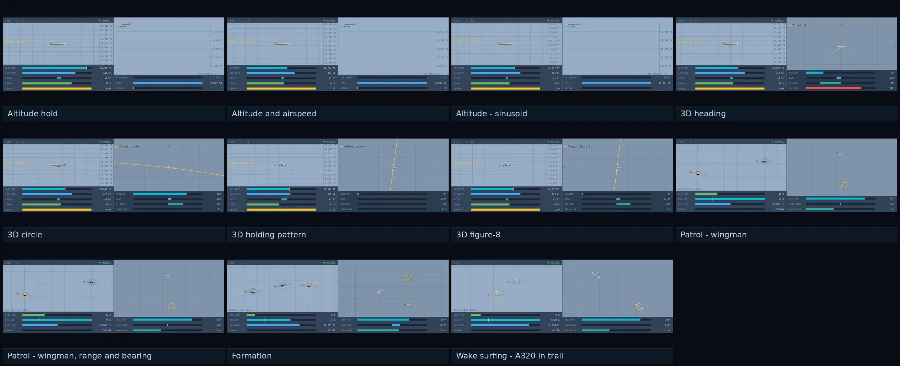
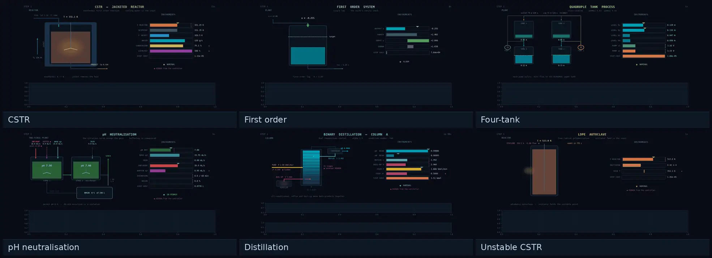
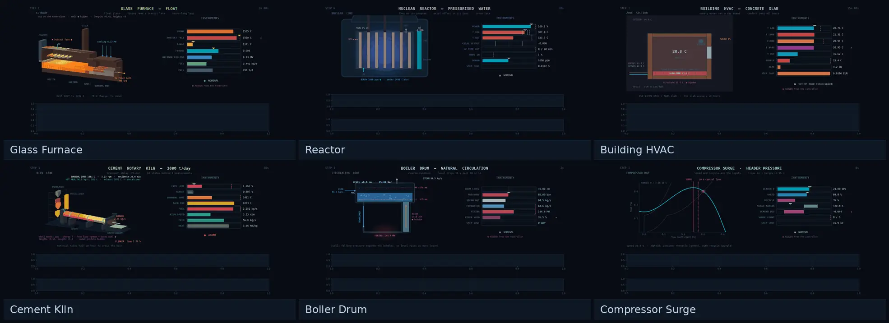
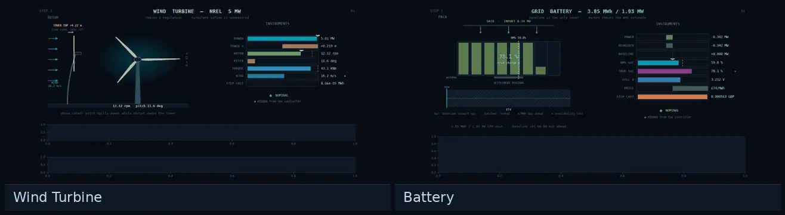

# Environment reference

Twenty-five environments, every one a *target MDP*: the objective is
to reach and hold a subset of the state space against disturbances, not to reach
a goal and stop.

<!-- Generated by scripts/generate_env_reference.py. Do not edit by hand:
     tests/test_docs.py fails when this file and the registry disagree. -->

Every environment implements the same interface, so the table below is the
whole of what differs between them:

- **Observation / Action** are the array shapes.
- **Tracked** is the quantity the target applies to, exposed at
  `env.obs_value_index` with its setpoint at `env.obs_target_index`, and named
  by `env.tracked_names`.
- **PID / MPC** say whether a baseline ships. Where one does not, the registry
  records why in `baselines_note` rather than leaving it silent, and the same
  note qualifies a shipped one that needs it (`patrol_range_bearing`'s MPC is a
  full-state bound).
- **Physics** links the environment's contract: sourced parameters, published
  validation targets asserted by tests, and quantified known deviations.

Load any of them by registry name, on the configuration it is scored on:

```python
import target_gym as tg

env, params = tg.make("boiler_drum")
```

To pick one by what you want to test, see
[Choosing an environment](complexity.md).


## Aircraft

<p align="center"></p>

| Environment | Cite as | Observation | Action | Tracked | PID | MPC | Physics |
|---|---|---|---|---|---|---|---|
| `plane` | `plane-v6` | (12,) | (2,) | altitude (m) | yes | no | [contract](https://github.com/YannBerthelot/TargetGym/blob/main/src/target_gym/plane/PHYSICS.md) |
| `plane_energy` | `plane_energy-v9` | (12,) | (2,) | altitude (m) | yes | no | [contract](https://github.com/YannBerthelot/TargetGym/blob/main/src/target_gym/plane/PHYSICS.md) |
| `plane_sine` | `plane_sine-v5` | (12,) | (2,) | altitude (m) | yes | yes | [contract](https://github.com/YannBerthelot/TargetGym/blob/main/src/target_gym/plane/PHYSICS.md) |
| `plane3d_heading` | `plane3d_heading-v8` | (19,) | (3,) | altitude (m) | yes | no | [contract](https://github.com/YannBerthelot/TargetGym/blob/main/src/target_gym/plane3d/PHYSICS.md) |
| `plane3d_circle` | `plane3d_circle-v5` | (17,) | (3,) | altitude (m) | yes | yes | [contract](https://github.com/YannBerthelot/TargetGym/blob/main/src/target_gym/plane3d/PHYSICS.md) |
| `plane3d_racetrack` | `plane3d_racetrack-v9` | (25,) | (3,) | altitude (m) | yes | no | [contract](https://github.com/YannBerthelot/TargetGym/blob/main/src/target_gym/plane3d/PHYSICS.md) |
| `plane3d_figure8` | `plane3d_figure8-v6` | (21,) | (3,) | distance to path (m) | yes | yes | [contract](https://github.com/YannBerthelot/TargetGym/blob/main/src/target_gym/plane3d/PHYSICS.md) |
| `patrol` | `patrol-v5` | (26,) | (3,) | slot error (m) | yes | yes | [contract](https://github.com/YannBerthelot/TargetGym/blob/main/src/target_gym/patrol/PHYSICS.md) |
| `patrol_range_bearing` | `patrol_range_bearing-v5` | (21,) | (3,) | measured range (m) | yes | yes | [contract](https://github.com/YannBerthelot/TargetGym/blob/main/src/target_gym/patrol/PHYSICS.md) |
| `formation` | `formation-v4` | (74,) | (9,) | lead altitude (m), wingman 0 slot error (m), wingman 1 slot error (m) | yes | yes | [contract](https://github.com/YannBerthelot/TargetGym/blob/main/src/target_gym/formation/PHYSICS.md) |
| `wake_surf` | `wake_surf-v2` | (26,) | (3,) | slot error (m) | yes | no | [contract](https://github.com/YannBerthelot/TargetGym/blob/main/src/target_gym/patrol/PHYSICS.md) |

> `plane` -- No oracle ships until the 2D oracle is rebuilt for the Amendment 2 score (+-65 ft and +-10 kt bands, plane/PHYSICS.md): the shipped model plans the earlier quadratic cost, so plane's room is not measured (charter rule 9).

> `plane_energy` -- No oracle ships until the 2D oracle is rebuilt for the Amendment 2 score (clearances on the AIM and RVSM bands, plane/PHYSICS.md): the shipped model plans the earlier cost, so plane_energy's room is not measured (charter rule 9).

> `plane3d_heading` -- No oracle ships until the 3D oracle is rebuilt for the Amendment 2 score (heading select scored on the RVSM, AIM and ACS bands, plane3d/PHYSICS.md): the shipped model plans the earlier cost, so the room is not measured (charter rule 9).

> `plane3d_racetrack` -- No oracle ships until the 3D oracle is rebuilt for the Amendment 2 score (the holding pattern's own legs, turns and speed, scored on the RVSM, AIM and ACS bands, plane3d/PHYSICS.md): the shipped model plans the earlier cost, so the room is not measured (charter rule 9).

> `patrol_range_bearing` -- The PID is a lead-state estimator feeding the same formation hold the full-observation variant uses. Range with azimuth and elevation is a complete relative-position measurement, so the only unobservable quantity is the lead's heading, which the slot needs because it is expressed in the lead's frame; the estimator takes the lead's velocity as the filtered rate of its position, with the follower's own motion added back, and its heading from that track less the crab the follower flies in the same air. The MPC slot holds patrol's oracle reading the true state, so it is a full-state bound, not a range-and-bearing controller. On a task defined by what the observation withholds, its score measures information and control together: what the hidden lead state is worth plus what a policy leaves on the table. It never reads the observation, so its per-step costs equal patrol's seed for seed.

> `formation` -- The PID flies the lead seat as a formation lead: the 3D heading task's course hold and pitch on height, aimed at the heading the route commands, at a set power, so its wingmen have a steady reference. Each wingman seat flies the patrol's formation hold. The MPC slot is the patrol oracle's design applied to the whole formation: the patrol's lead autopilot in the lead seat and its twin-autopilot law in each wingman seat, with one residual planner over every seat on the team cost.

> `wake_surf` -- No MPC ships yet: the patrol's twin-autopilot oracle plans the slot, not the station's economy, and the shared solver is not wired to this task (owner, 2026-11-10).

## Process Control

<p align="center"></p>

| Environment | Cite as | Observation | Action | Tracked | PID | MPC | Physics |
|---|---|---|---|---|---|---|---|
| `cstr` | `cstr-v6` | (4,) | (1,) | T (K) | yes | yes | [contract](https://github.com/YannBerthelot/TargetGym/blob/main/src/target_gym/pc_gym/cstr/PHYSICS.md) |
| `first_order` | `first_order-v4` | (2,) | (1,) | x | yes | yes | [contract](https://github.com/YannBerthelot/TargetGym/blob/main/src/target_gym/pc_gym/first_order/PHYSICS.md) |
| `four_tank` | `four_tank-v6` | (6,) | (2,) | h1 (m), h2 (m) | yes | yes | [contract](https://github.com/YannBerthelot/TargetGym/blob/main/src/target_gym/pc_gym/four_tank/PHYSICS.md) |
| `ph_neutralization` | `ph_neutralization-v5` | (8,) | (2,) | pH | yes | yes | [contract](https://github.com/YannBerthelot/TargetGym/blob/main/src/target_gym/pc_gym/ph_neutralization/PHYSICS.md) |
| `distillation` | `distillation-v8` | (8,) | (2,) | yD (mole fraction), xB (mole fraction) | yes | yes | [contract](https://github.com/YannBerthelot/TargetGym/blob/main/src/target_gym/pc_gym/distillation/PHYSICS.md) |
| `unstable_cstr` | `unstable_cstr-v6` | (3,) | (1,) | T (K) | yes | yes | [contract](https://github.com/YannBerthelot/TargetGym/blob/main/src/target_gym/pc_gym/unstable_cstr/PHYSICS.md) |

## Industrial / Energy

<p align="center"></p>

| Environment | Cite as | Observation | Action | Tracked | PID | MPC | Physics |
|---|---|---|---|---|---|---|---|
| `glass_furnace` | `glass_furnace-v4` | (12,) | (1,) | fining share read at the cold end | yes | yes | [contract](https://github.com/YannBerthelot/TargetGym/blob/main/src/target_gym/glass_furnace/PHYSICS.md) |
| `reactor` | `reactor-v6` | (11,) | (2,) | Tavg (K) | yes | yes | [contract](https://github.com/YannBerthelot/TargetGym/blob/main/src/target_gym/reactor/PHYSICS.md) |
| `hvac` | `hvac-v5` | (12,) | (1,) | zone air temperature (deg C) | yes | yes | [contract](https://github.com/YannBerthelot/TargetGym/blob/main/src/target_gym/hvac/PHYSICS.md) |
| `cement_kiln` | `cement_kiln-v4` | (8,) | (2,) | discharge free lime (%) | yes | yes | [contract](https://github.com/YannBerthelot/TargetGym/blob/main/src/target_gym/cement_kiln/PHYSICS.md) |
| `boiler_drum` | `boiler_drum-v5` | (12,) | (2,) | drum level (m), drum pressure (bar) | yes | yes | [contract](https://github.com/YannBerthelot/TargetGym/blob/main/src/target_gym/boiler_drum/PHYSICS.md) |
| `compressor_surge` | `compressor_surge-v4` | (8,) | (2,) | header pressure (kPa) | yes | yes | [contract](https://github.com/YannBerthelot/TargetGym/blob/main/src/target_gym/compressor_surge/PHYSICS.md) |

> `glass_furnace` -- The plant was rebuilt (attempt 3: a float melter in two dimensions, scored in money on fuel and lost glass). The PID is the reference ladder's first rung, a PI on the cold-end fining reading two sigma above its pass mark. The oracle plans the valve on the env's own step and reward, with the episode's walks foreseen when given its seed, by SLSQP, which does not converge on this plant's ratchet: its plans bound the ceiling from above (glass_furnace/oracle.py).

## Renewable Energy

<p align="center"></p>

| Environment | Cite as | Observation | Action | Tracked | PID | MPC | Physics |
|---|---|---|---|---|---|---|---|
| `wind_turbine` | `wind_turbine-v5` | (7,) | (2,) | electrical power (MW) | yes | yes | [contract](https://github.com/YannBerthelot/TargetGym/blob/main/src/target_gym/energy/wind_turbine/PHYSICS.md) |
| `battery` | `battery-v5` | (17,) | (1,) | delivered power (MW) | yes | yes | [contract](https://github.com/YannBerthelot/TargetGym/blob/main/src/target_gym/energy/battery/PHYSICS.md) |
